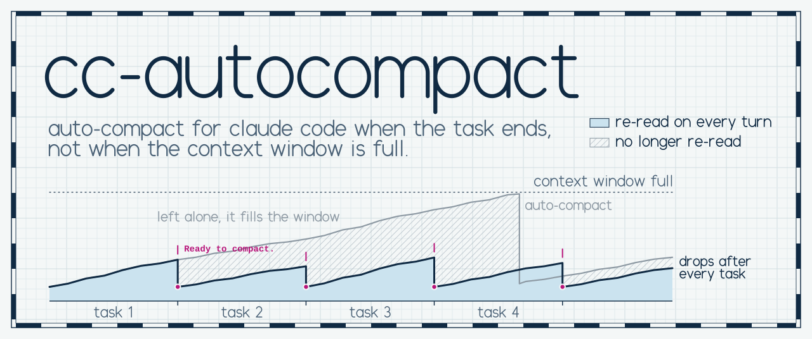
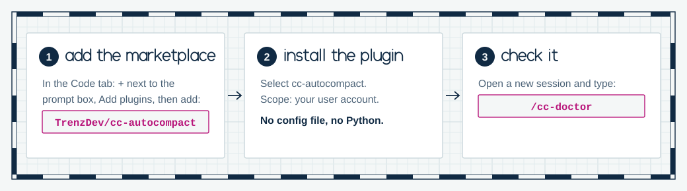
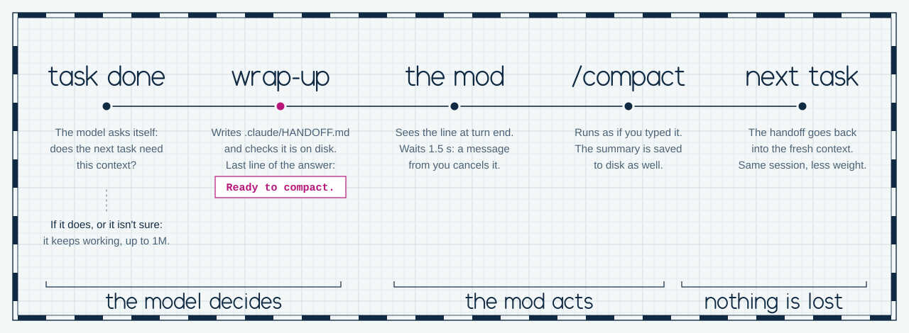
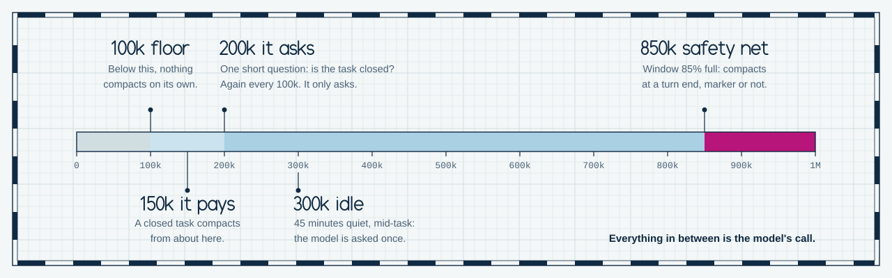
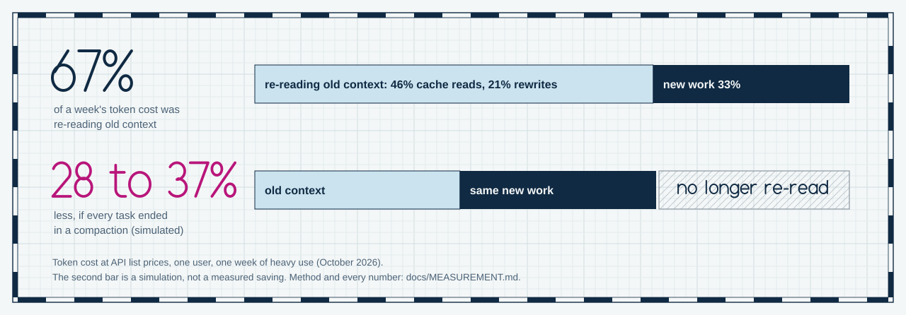

<picture>
  <source media="(prefers-color-scheme: dark)" srcset="assets/banner-dark.svg">
  
</picture>

<h1 align="center">cc-autocompact</h1>

<p align="center">
  <b>Auto-compact for Claude Code when the task ends, not when the context window is full.</b><br>
  One plugin for the desktop app and the terminal. No Python, nothing to configure.
</p>

<p align="center">
  <a href="https://github.com/TrenzDev/cc-autocompact/releases/latest"></a>
  <a href="LICENSE"></a>
  <a href="docs/ARCHITECTURE.md#tests"></a>
  <a href="SECURITY.md"></a>
  <a href="#install"></a>
</p>

<p align="center">
  <a href="#install"><b>Install</b></a> ·
  <a href="#how-it-works"><b>How it works</b></a> ·
  <a href="#when-it-acts"><b>When it acts</b></a> ·
  <a href="#what-i-measured"><b>What I measured</b></a> ·
  <a href="docs/CONFIGURATION.md"><b>Configuration</b></a> ·
  <a href="#faq"><b>FAQ</b></a>
</p>

My 5-hour usage limit in Claude Code was running out in under two hours. When I measured a week of my sessions, **two thirds of the token cost was the model re-reading its own past**: context from tasks that were already finished, dragged into every new turn.

Claude Code compacts when the window is nearly full. By then a long session has carried several finished tasks through hundreds of turns. So I moved the trigger to the end of the task.

<picture>
  <source media="(prefers-color-scheme: dark)" srcset="assets/demo-dark.svg">
  
</picture>

## What you get

| | |
| --- | --- |
| **Compacts when a task ends** | The model ends with `Ready to compact.` and the plugin runs `/compact`. Same session, same thread, a lot less weight. |
| **Asks, it doesn't cut** | If a task needs a million tokens, it gets them. From 200k the model only gets a short question. The one exception is a window about to overflow. |
| **Only when it pays** | A small policy weighs what compacting costs against what it saves later. Under about 150k it doesn't compact. |
| **Nothing gets lost** | A handoff is written first, the full summary is saved to disk, and the handoff goes back into the fresh context. |
| **Works while you're away** | After 45 minutes quiet, with the cache still warm, a closed task compacts and a busy one is asked once. |
| **Respects your limits** | Near the 5-hour or weekly limit, messages from other sessions and schedules get a note to keep work light. A message from you is never touched. |
| **Stays on your machine** | No network, no telemetry, no shell. The log holds numbers, never your text. See [SECURITY.md](SECURITY.md). |

## Install

<picture>
  <source media="(prefers-color-scheme: dark)" srcset="assets/install-dark.svg">
  
</picture>

### In the desktop app

1. In the **Code** tab, click **+** next to the prompt box and choose **Add plugins**. If the menu shows **Plugins** instead, choose **Plugins**, then **Browse plugins**.
2. Add the marketplace `TrenzDev/cc-autocompact`, select **cc-autocompact**, and choose your user account as the scope.
3. Open a new session and type `/cc-doctor`. If it isn't there, restart the app.

**Or let Claude do it.** Paste this into any session in the Code tab, then open a new session:

```text
Install the cc-autocompact plugin. Run: claude plugin install cc-autocompact --marketplace TrenzDev/cc-autocompact
If claude isn't on the PATH, run the same thing with the engine in the CLAUDE_CODE_EXECPATH environment variable.
```

### In the terminal

```bash
claude plugin install cc-autocompact --marketplace TrenzDev/cc-autocompact
```

A plugin installed at the user scope also loads in the desktop app and in VS Code. That line needs Claude Code 2.1.275 or later; on an older one, run `claude plugin marketplace add TrenzDev/cc-autocompact` first and then `claude plugin install cc-autocompact@cc-autocompact`.

### Optional: close tasks sooner

The plugin works without this: from 200k it asks the model by itself. This rule in your `CLAUDE.md` (`~/.claude/CLAUDE.md` for every project) makes the model also close smaller tasks without being asked, and tells `/compact` what to keep:

```markdown
## Closing tasks
When you finish a task, ask yourself whether the next one needs the context you are carrying.
If it doesn't, run the wrap-up skill: leave the handoff and end with "Ready to compact.".
If it does, or you are not sure, keep going. Decide by the task, never by the context size.

# Compact instructions
Keep the user's decisions word for word, with dates; what was done, with paths and proof;
what is pending and who owns it; the exact next step.
```

<details>
<summary><b>Without the marketplace, from a clone</b></summary>

`./install.sh` on macOS and Linux, `.\install.ps1` on Windows. They copy the plugin to `~/.claude/mods/cc-autocompact` and print the one line that goes in `settings.json` (or add it, after a backup, with `--apply-settings` / `-ApplySettings`). This is how I run it myself.

</details>

<details>
<summary><b>Where it is tested</b></summary>

Honestly: on one machine. Windows 11, the desktop app (Code tab), every day since 31 October 2026, 0.6.0 since 4 November, now on engine 2.1.317. The install from the marketplace was run with the app's own engine against a clean config folder. The clicks in the plugin browser come from the [official docs](https://code.claude.com/docs/en/discover-plugins), since my own copy runs from a clone.

The plugin only talks to Claude Code's mod API, which is the same on every platform, so I expect it to work on macOS, Linux and in the terminal, but I haven't run it there. If you try it somewhere else, an issue saying "works" or "doesn't" helps a lot. The mod API is early access and changes between releases.

</details>

## Day to day

Most of the time you do nothing. The model closes each task that doesn't need its context carried forward, and you see two short toasts.

| Command | What it does |
| --- | --- |
| `/wrap-up` | Close the task yourself. If the session is above the floor, it compacts. |
| `/compact-now` | Wrap up and compact now, in any session, with no floor. |
| `/cc-doctor` | A short, read-only report: config, log, the last week's events, rate limits, context, and anything that would stop it working. |

To keep the context, tell the model ("I'll keep going with this later"). If you see the toast and don't want the compaction, send anything in the next second and a half.

## How it works

<picture>
  <source media="(prefers-color-scheme: dark)" srcset="assets/flow-dark.svg">
  
</picture>

1. **The model decides.** At the end of a task it asks whether the next one needs this context. If not, the `wrap-up` skill updates a handoff file and ends with the exact line `Ready to compact.` If yes, or if it isn't sure, it keeps working.
2. **The mod acts.** It sees that line when the turn ends and queues `/compact`, as if you had typed it. It has to be a mod: no hook, no skill and not the model itself can run `/compact`.
3. **Nothing is lost.** The handoff is written before anything happens. When the compaction ends, the mod saves the full summary to disk and puts the handoff back into the fresh context.

Every design choice, with links to the official docs, is in [docs/DECISIONS.md](docs/DECISIONS.md). Events, state and failure modes are in [docs/ARCHITECTURE.md](docs/ARCHITECTURE.md).

## When it acts

<picture>
  <source media="(prefers-color-scheme: dark)" srcset="assets/gauge-dark.svg">
  
</picture>

The marks are for a window of a million tokens. In a smaller window the question starts at 40% and repeats every 10%, never below the floor. All of them are settings: see [docs/CONFIGURATION.md](docs/CONFIGURATION.md).

<a id="the-reminder"></a>
<details>
<summary><b>The question the model gets</b></summary>

A rule in `CLAUDE.md` depends on the model remembering it. In my sessions it didn't: the first six compactions all came from someone asking, with 500k to 880k of context on board. So when a message comes in between turns on the main thread, and the context has crossed a new band, the model gets this next to the message:

> [cc-autocompact] Context is at 512k. This is a question, not an order: is the task closed, and does what comes next not need this context?
> If yes: answer this message if it is short; if it asks for something long and comes from the user, leave it as the next step and say you will need a nudge after compacting. If it comes from another session, don't compact yet: that session doesn't see your reply and nobody would give you the nudge, so do what it asks and wrap up when that is done. If another session is waiting for a reply, send it before you wrap up. Wrap up (the wrap-up skill, unless your instructions name another) and end with the exact line "Ready to compact.".
> If no (a task in progress, a long document, a batch, the user iterating), or you aren't sure: carry on and don't mention this. Using the whole context window is fine when the task needs it.

It stays quiet while a turn is running, and for background tasks, commands and subagents. It starts over after any compaction. Each question is about 150 tokens, with at most nine between 200k and a million. `"reminder": false` turns it off.

A message can also arrive during the 1.5 seconds before a compaction and cancel it. The model is told so, once, and the mod tries once more if the next turn is a short answer. The reasoning is in [D19](docs/DECISIONS.md#d19-size-may-ask-it-never-decides).

</details>

## What I measured

<picture>
  <source media="(prefers-color-scheme: dark)" srcset="assets/before-after-dark.svg">
  
</picture>

These are my numbers, from one week of heavy use, at API list prices. Yours will be different, so measure before you trust mine.

| | |
| --- | --- |
| **67%** | of the token cost went to carrying old context (46% cache reads, 21% rewrites) |
| **3x** | the cost per turn above 600k against 100k to 200k, for the same useful work |
| **28 to 37%** | simulated saving from closing at task boundaries. A simulation, not a saving I observed |
| **12** | compactions on the first working day of 0.6.0, with a median of 446k down to 33k |

That 33k is what the engine reports right after compacting; the next turn adds your system prompt, tools and `CLAUDE.md` on top. The plugin's own ledger for that day says $9.6 saved against $7.8 spent on the compactions themselves, and the saving keeps growing with every later turn. The first full week ends on 7 November and its numbers will replace the simulation here.

<details>
<summary><b>The full table</b></summary>

| What I found | Number |
| --- | --- |
| Share of the token cost spent carrying old context (re-reading it from cache, or rewriting it after the cache expired) | **67%** (46% cache reads, 21% rewrites) |
| Share that was new work | 33% (16% model output, 17% new context) |
| Turns that ran with more than 200k of context | 68%, and they made up 82% of the cost |
| Cost per turn above 600k, compared with 100k to 200k | 3x. The carrying part, 5x. The useful work per turn stayed flat. |
| Reopening a big session after more than an hour (the cache had expired 99% of the time) | 18% of the total |
| Average context when I compacted | 520k (three times out of four by hand, and late) |
| Simulated saving from closing at task boundaries with a small handoff | 28% to 37%, depending on the assumptions |

The simulation also showed that the task boundary is what pays, not the size. Closing at the end of each task saved 33%. Adding a size cap on top only added two points. It assumes each task restarts from a 30k summary.

The first live run was on 31 October 2026: the plugin saw the line and compacted a session of 779,856 tokens; the next turn ran with 122,599.

</details>

<details>
<summary><b>Measure your own usage</b></summary>

Before you install it, and a week later:

```bash
python tools/measure_context.py                 # last 7 days
python tools/measure_context.py --days 14 --top 20
python tools/measure_context.py --compare 2026-10-25T00:00+02:00 2026-11-01T00:00+01:00 \
                                          2026-11-01T00:00+01:00 2026-11-08T00:00+01:00 \
                                --log ~/.claude/cc-autocompact/compactions.jsonl
```

It reads your transcripts in `~/.claude/projects`, read-only, and never prints the text of a conversation. Session titles only show with `--titles`, so the default output is safe to share. `--compare` puts two windows side by side and, with the plugin's log, estimates what its own compactions saved. Two weeks of different work differ a lot on their own, so that direct estimate is the number to look at.

Amounts are at API list prices (editable in the script, or with `--prices`). On a subscription, look at the percentages. Full method in [docs/MEASUREMENT.md](docs/MEASUREMENT.md).

</details>

## Configuration

Nothing is required. To change something, create `~/.claude/cc-autocompact/config.json` with only the keys you want. The mod reads it on every use, so edits apply right away, and updating the plugin never touches it.

| The ones people change | Default | What it does |
| --- | --- | --- |
| `enabled` | `true` | With `false`, only `/compact-now` works. |
| `sessions` | `["*"]` | Which sessions compact on their own. A list like `["Backend", "Docs"]` matches titles in the desktop app. |
| `reminder_tokens` | `200000` | The context the question starts at. |
| `idle_mode` | `"ask"` | When idle: `"ask"`, `"closed"`, `"any"` or `"off"`. |
| `compact_instructions` | keep decisions, paths, pending, next step | What the summary must keep. Write it in the language you want your summaries in. |
| `usd_per_point` | `null` | USD per point of your plan's usage, to show the weekly saving in points too. |

Every key, the handoff file, the log, your own wrap-up skill and an end-to-end check are in **[docs/CONFIGURATION.md](docs/CONFIGURATION.md)**.

## FAQ

<details>
<summary><b>How is this different from Claude Code's own auto-compact?</b></summary>

Auto-compact decides by size: it fires near the end of the context window ([model-config](https://code.claude.com/docs/en/model-config#set-the-auto-compact-window)) or after a while idle ([settings-reference](https://code.claude.com/docs/en/settings-reference#idlecompaction)). This decides by task: it compacts when a task ends and the next thing is something else, which is the moment old context stops being useful. Both run side by side. Auto-compact stays as the safety net, and I don't touch it.

</details>

<details>
<summary><b>Why compact instead of <code>/clear</code>?</b></summary>

`/clear` costs nothing and leaves a clean context, but you lose the visible history and the thread of what was decided. Compacting is one big request ([costs](https://code.claude.com/docs/en/costs#why-usage-climbs-in-a-long-session)), but it keeps a summary and it is still the same session. You pay for the compaction once, when a task closes. You pay for old context on every turn. If you prefer `/clear`, the mod puts the handoff back after a `/clear` too.

</details>

<details>
<summary><b>How do you avoid losing detail?</b></summary>

Four layers. (1) The handoff is written first; if anything fails, the skill doesn't write the marker, so nothing compacts. (2) The compact instructions ask for decisions, pending items, paths and the next step. (3) The full summary is saved to disk. (4) The handoff goes back into the context, and Claude Code itself reloads `CLAUDE.md`, memory and the most recent files ([context-window](https://code.claude.com/docs/en/context-window#what-survives-compaction)). On top of that, the model only closes when the next task doesn't need the context, and when in doubt it doesn't close.

</details>

<details>
<summary><b>How much does it save?</b></summary>

I don't know yet from a full week. The simulation on a week of my data gave 28% to 37%, but it assumed a clean restart with a small handoff. Compacting leaves a summary behind, plus what Claude Code reloads by itself, and you pay for the request that writes it. So the real saving will be lower than the simulation. Measure it yourself, before and after, and `/cc-doctor` shows the plugin's own estimate.

</details>

<details>
<summary><b>There are other tools for this. Which one do I want?</b></summary>

Some I know of: [compactly](https://github.com/swapnildahiphale/compactly) asks a second model at each new prompt whether this is a good moment to compact. [catnap](https://github.com/LippInc/catnap) lets Claude compact itself once the context passes 50%. [claude-auto-handoff](https://github.com/alexknowshtml/claude-auto-handoff) hands a long session to a fresh one with a brief, instead of compacting. In this one there is no second model: the model that did the work says when the task is over, and the handoff is written before anything is compacted. If you want compaction by size, Claude Code's own `/autocompact` setting already does that.

</details>

<details>
<summary><b>It doesn't compact. How do I debug it?</b></summary>

Run `/cc-doctor` first. Then set `"debug": true` in `config.json` (applies right away). Every turn end shows a toast like `debug: reason=answer · answer=yes "…Ready to compact." · ctx=746k · decision: compact`, or `decision: no: <why>`, and writes the same line to `debug.jsonl`. Common reasons: `no marker`, `under the floor`, `enabled is false`, `this session is not in sessions`, `already compacted, no new turn since`. If `/compact-now` doesn't show up when you type `/`, the plugin didn't load: check `claude plugin list`.

</details>

<details>
<summary><b>Does it affect subagents?</b></summary>

No. The mod ignores subagent turns and only acts on the main thread. The question doesn't reach them either.

</details>

<details>
<summary><b>What if the model never closes a task?</b></summary>

Then nothing compacts until Claude Code's own auto-compact does, and that is fine. From 200k the question asks it, and it can always say no. You can also use `/compact-now`.

</details>

<details>
<summary><b>Why does the mod run <code>/compact</code> instead of <code>$.session.compact()</code>?</b></summary>

Because in the desktop app every session runs headless (SDK), and there `$.session.compact()` always rejects: *"not available in a headless (-p / SDK) session yet: compaction here runs inside a turn (a /compact prompt)"*. The mod queues `/compact` with `$.command.run`, which runs the command as if you typed it, as soon as the session is idle. See the [CHANGELOG](CHANGELOG.md).

</details>

<details>
<summary><b>Known limits</b></summary>

- The mod API is early access. It changes between releases, and the types the engine ships are the reference.
- Nothing outside the UI can run `/compact`: not a hook, not a skill, not the model, not a message from another session (it arrives as text). That's why this needs a mod.
- A mod can't send text that starts with `/`, so `/compact-now` runs the skill as a command and, if that fails, asks for it in plain words.
- The session title isn't in the API. The mod reads it from the desktop app's own files, and only needs it for a list in `sessions`. With `["*"]` it doesn't.
- After a compaction the session waits for you. If the message that brought the question also asked for something long, the model leaves it as the next step and says so, but someone has to say "go on". The mod doesn't.
- What goes back after a compaction is the copy of the handoff taken when the last wrap-up ended. If you edit the file by hand after that, your edit comes back after the next wrap-up. In a project where no wrap-up has run, nothing comes back. That's on purpose ([SECURITY.md](SECURITY.md)).
- The mod API has no append. The log is read and rewritten, so two compactions in the same instant could overwrite one line.
- Any answer ending in the marker triggers it. If you have other closing skills, give them another last line, or let them compact on purpose.

</details>

## Turn it off or uninstall

| You want | Do this |
| --- | --- |
| No automatic compaction, but keep `/compact-now` | `{"enabled": false}` in `~/.claude/cc-autocompact/config.json`. Applies right away. |
| The plugin gone | In the desktop app: **+**, **Plugins**, **Manage plugins**. In a shell: `claude plugin uninstall cc-autocompact`. If you used an installer, remove the folder from `CLAUDE_CODE_PLUGIN_DIRS` in `settings.json`. |

Your saved summaries stay in `~/.claude/compaction-summaries` and the log in `~/.claude/cc-autocompact`. Don't run another mod that also compacts on its own at the same time: both would react to the same marker.

## What's in the repo

| Piece | Where | What it does |
| --- | --- | --- |
| The plugin | [`plugin/`](plugin/) | One mod plus one skill. |
| Tests | [`plugin/hooks/`](plugin/hooks/) | 167 tests against the real engine: `claude plugin test plugin` and `claude plugin validate plugin`. The desktop app's `claude.exe` works too. |
| Security | [`SECURITY.md`](SECURITY.md) | What it reads and writes, the threat model, and how to report a problem privately. |
| Tools | [`tools/`](tools/) | `measure_context.py` measures your usage; `simulate.py` replays usage traces to price what-if policies. |
| Images | [`assets/`](assets/) | The drawings in this README: `python assets/make_assets.py --png`. |

## License

[MIT](LICENSE). Copyright (c) 2026 Mario TM.
