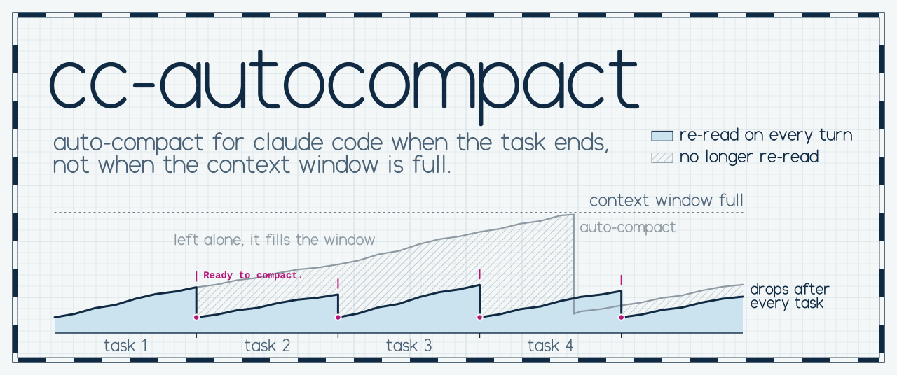
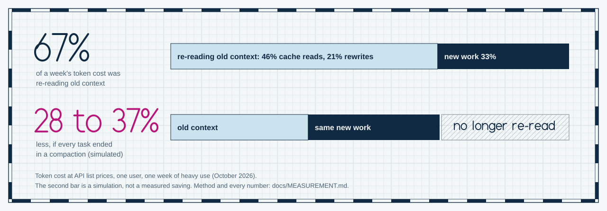
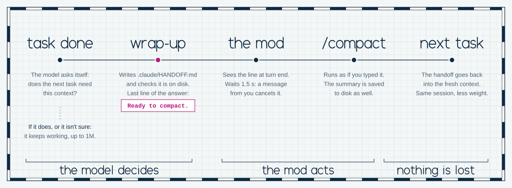

<picture>
  <source media="(prefers-color-scheme: dark)" srcset="assets/banner-dark.svg">
  
</picture>

# cc-autocompact

**Auto-compact for Claude Code at the end of each task, not when the context window is full.** One plugin: no Python, nothing to configure.

My 5-hour usage limit in Claude Code was running out in under two hours. When I measured a week of my sessions, two thirds of the token cost (at API list prices) was the model re-reading its own past: context from tasks that were already finished, dragged into every new turn.

Claude Code compacts on its own when the context window is nearly full. By then a long session has carried several finished tasks through hundreds of turns.

So I moved the trigger. When the model finishes a task and the next one doesn't need that context, it writes a short handoff to disk and ends its message with one line: `Ready to compact.` The plugin sees that line and runs `/compact`. It saves the summary and puts the handoff back into the fresh context. Same session, same thread, a lot less weight.

Size never compacts anything. If a task needs a million tokens, it gets a million tokens. Past 400k the plugin only asks the model, now and then, whether the task is closed.

<picture>
  <source media="(prefers-color-scheme: dark)" srcset="assets/demo-dark.svg">
  
</picture>

<!-- DEMO: when the screen recording exists, put assets/demo.gif here (see assets/make_demo.py) and keep the illustration below it. -->

## Install

In a Claude Code session in the terminal:

```text
/plugin install cc-autocompact --marketplace TrenzDev/cc-autocompact
```

Answer `y` to add the marketplace and pick the user scope. That one line needs Claude Code 2.1.275 or later; on an older one, run `/plugin marketplace add TrenzDev/cc-autocompact` first and then `/plugin install cc-autocompact@cc-autocompact`. From a shell it is the same line: `claude plugin install cc-autocompact --marketplace TrenzDev/cc-autocompact`. In the desktop app, where `/plugin` doesn't run: click **+** next to the prompt box, **Plugins**, **Add marketplace** with `TrenzDev/cc-autocompact`, then add the plugin. A plugin installed from the terminal at the user scope also loads in the desktop app.

Then add this rule to your `CLAUDE.md` (`~/.claude/CLAUDE.md` for every project, or a project's own). It is what makes the model close tasks by itself:

```markdown
## Closing tasks
When you finish a task, ask yourself whether the next one needs the context you are carrying.
If it doesn't, run the wrap-up skill: leave the handoff and end with "Ready to compact.".
If it does, or you are not sure, keep going. Decide by the task, never by the context size.

# Compact instructions
Keep the user's decisions word for word, with dates; what was done, with paths and proof;
what is pending and who owns it; the exact next step.
```

Start a new session and type `/`: `/compact-now` should be there. That's all. There is no config file to write: the defaults are in the table under [Configuration](#configuration).

**Without the marketplace**, from a clone: `./install.sh` on macOS and Linux, `.\install.ps1` on Windows. They copy the plugin to `~/.claude/mods/cc-autocompact` and print the one line that goes in `settings.json` (or add it, after a backup, with `--apply-settings` / `-ApplySettings`).

### Where it is tested

Honestly: on one machine. Windows 11, the Claude Code desktop app (Code tab), engine 2.1.309, every day since 31 October 2026. The plugin only talks to Claude Code's mod API, which is the same on every platform, so I expect it to work on macOS and Linux and in the terminal, but I haven't run it there. The installers for macOS and Linux were tested in a temporary folder, not on a Mac. If you try it somewhere else, an issue saying "works" or "doesn't" helps a lot.

The mod API is early access and changes between releases. Engine 2.1.309 is the only version I have tested.

## Why: what I measured

<picture>
  <source media="(prefers-color-scheme: dark)" srcset="assets/before-after-dark.svg">
  
</picture>

These are my numbers: one week of heavy use in October 2026, main sessions and subagents, measured with [`tools/measure_context.py`](tools/measure_context.py). The method is in [docs/MEASUREMENT.md](docs/MEASUREMENT.md). Yours will be different, so measure before you trust mine.

| What I found | Number |
| --- | --- |
| Share of the token cost spent carrying old context (re-reading it from cache, or rewriting it after the cache expired) | **67%** (46% cache reads, 21% rewrites) |
| Share that was new work | 33% (16% model output, 17% new context) |
| Turns that ran with more than 200k of context | 68%, and they made up 82% of the cost |
| Cost per turn above 600k, compared with 100k to 200k | 3x. The carrying part, 5x. The useful work per turn stayed flat. |
| Reopening a big session after more than an hour (the cache had expired 99% of the time) | 18% of the total |
| Average context when I compacted | 520k (three times out of four by hand, and late) |
| Simulated saving from closing at task boundaries with a small handoff | 28% to 37%, depending on the assumptions |

The simulation also showed that the task boundary is what pays, not the size. Closing at the end of each task saved 33%. Adding a size cap on top only added two points. It is a simulation with assumptions (each task restarts from a 30k summary), not a saving I observed.

The first live run was on 31 October 2026: the plugin saw the line and compacted a session of 779,856 tokens; the next turn ran with 122,599. The first full week with it switched on ends on 7 November, and its numbers will replace the simulation here. The meter already compares two weeks and estimates what the plugin's own compactions saved (`--compare`, below).

## How it works

<picture>
  <source media="(prefers-color-scheme: dark)" srcset="assets/flow-dark.svg">
  
</picture>

1. **The model decides.** At the end of a task it asks: does the next task need this context? If not, it runs the `wrap-up` skill, which updates a handoff file and ends with the exact line `Ready to compact.` If yes, or if it isn't sure, it keeps working. Models forget, so when a message comes in and the context is high, the mod [asks the question for it](#the-reminder).
2. **The mod acts.** It sees that line when the turn ends and queues `/compact`, as if you had typed it. It has to be a mod: no hook, no skill and not the model itself can run `/compact`.
3. **Nothing is lost.** The handoff is written before anything happens. When the compaction ends, the mod saves the full summary to disk and puts the handoff back into the fresh context.

`/compact-now` does it on demand: wrap-up, then compact, in any session and with no floor. I compact instead of `/clear` to keep the thread and the visible history. Every design choice, with links to the official docs, is in [docs/DECISIONS.md](docs/DECISIONS.md). Events, state and failure modes are in [docs/ARCHITECTURE.md](docs/ARCHITECTURE.md).

### The reminder

A rule in `CLAUDE.md` depends on the model remembering it. In my sessions it didn't: the first six compactions all came from someone asking, with 500k to 880k of context on board. So when a message comes in between turns on the main thread, from you or from another session, and the context has crossed a new band (from 400k, once on crossing and again every 100k more), the model gets one short question next to the message:

> [cc-autocompact] Context is at 512k. This is a question, not an order: is the task closed, and does what comes next not need this context?
> If yes: answer this message if it is short; if it asks for something long, leave it as the next step and say you will need a nudge after compacting. Wrap up (the wrap-up skill, unless your instructions name another) and end with the exact line "Ready to compact.".
> If no (a task in progress, a long document, a batch, the user iterating), or you aren't sure: carry on and don't mention this. Using the whole context window is fine when the task needs it.

It asks, and that's all it does. Nothing compacts unless the model writes the marker, and it may keep going to the end of the window if the task needs it. It stays quiet while a turn is running, and for background tasks, commands and subagents. It starts over after any compaction. Each question is about 150 tokens, and there are at most seven between 400k and a million.

A message can also arrive during the 1.5 seconds before a compaction and cancel it. The model is told so, once, next to that message, and asked to write the marker again when it finishes answering, if that still applies. Nothing used to tell it, and the compaction was lost until someone remembered.

The numbers are `reminder_tokens` and `reminder_every_tokens`, and `"reminder": false` turns both notes off. In a window under a million, the threshold drops to 40% of the window and the step to 10%, never below `min_context_tokens`. The reasoning, with the numbers I simulated, is in [D19](docs/DECISIONS.md#d19-size-may-ask-it-never-decides).

## What's in the repo

| Piece | Where | What it does |
| --- | --- | --- |
| The plugin | [`plugin/`](plugin/) | One mod plus one skill. The mod compacts when it sees the marker, asks the model whether the task is closed when the context is high, saves every compaction summary, puts the handoff back after a compaction or a `/clear`, and adds `/compact-now`. It talks through short toasts and logs each compaction to a JSONL file. |
| `wrap-up` skill | [`plugin/skills/wrap-up/`](plugin/skills/wrap-up/SKILL.md) | When to close, the handoff file, an optional step for your own system, and the marker line. |
| Tests | [`plugin/hooks/register.test.ts`](plugin/hooks/register.test.ts) | 89 tests that run against the real engine with `claude plugin test plugin`, 30 of them on security. |
| Security | [`SECURITY.md`](SECURITY.md) | What it reads and writes (no network, no shell), the threat model, and how to report a problem privately. |
| Meter | [`tools/measure_context.py`](tools/measure_context.py) | Reads your local transcripts and tells you how much of your token usage is carrying context. Compares two weeks with `--compare`. |
| Installers | [`install.sh`](install.sh), [`install.ps1`](install.ps1) | For a clone, without the marketplace. |
| Images | [`assets/`](assets/) | The images in this README, drawn as SVG by [`make_assets.py`](assets/make_assets.py) with its own pen lettering ([`lettering.py`](assets/lettering.py)). |

## Configuration

Nothing is required. To change something, create `~/.claude/cc-autocompact/config.json` with only the keys you want ([`config.example.json`](plugin/config.example.json) has them all). The mod reads it on every use, so edits apply right away. It lives outside the plugin folder, so updating the plugin never touches it.

| Key | Default | What it does |
| --- | --- | --- |
| `enabled` | `true` | Switch for the automatic trigger. With `false`, only `/compact-now` works. |
| `sessions` | `["*"]` | Which sessions compact on their own. `["*"]`: all of them (the marker only shows up when the model closes a task). A list like `["Backend", "Docs"]`: only sessions whose title in the desktop app contains one of those words. `[]`: none. |
| `min_context_tokens` | `80000` | Below this, the marker doesn't compact: compacting something small isn't worth it. It is a floor, never a ceiling. |
| `reminder` | `true` | Switch for [the reminder](#the-reminder) and for the note about a cancelled compaction. With `false`, the mod adds nothing to your messages. |
| `reminder_tokens` | `400000` | The context the reminder starts asking at (or 40% of the window, if that is less). It only asks: it never compacts. |
| `reminder_every_tokens` | `100000` | How many tokens more before it asks again (or 10% of the window, if that is less). |
| `delay_ms` | `1500` | Time between the toast and the compaction. A message from you or a new turn in that window cancels it. |
| `marker` | `"Ready to compact."` | The last line that means "task closed, everything saved". Change it for another language, and change the skill's last line to match. |
| `compact_instructions` | keep decisions, paths, pending, next step | What the summary must keep (what goes after `/compact`). Write it in the language you want your summaries in. |
| `close_skill` | `"wrap-up"` | The skill `/compact-now` runs, with arguments if it takes any (`"my-close light"`). It has to end with the marker. |
| `summaries_dir` | `""` | Where summaries are saved. `""`: `~/.claude/compaction-summaries/<project>/`. `"off"`: not saved. Another folder must be inside `~/.claude`. |
| `reinject_handoff` | `true` | Put the handoff back into the context after a compaction or a `/clear`. |
| `handoff_max_chars` | `12000` | Longest handoff that is put back (500 to 50,000). A longer one is cut, with a note saying where the full file is. |
| `debug` | `false` | Every turn end shows a toast with the decision and writes a line to `debug.jsonl` (last 400 lines). For debugging. |
| `log_file` | `""` | The compaction log. `""`: `~/.claude/cc-autocompact/compactions.jsonl`. Another one must be a `.jsonl` inside `~/.claude/cc-autocompact`. |
| `app_sessions_dir` | `""` | Where the desktop app keeps session titles. Only used with a list in `sessions` and for titles in the log. On Windows it is found by itself. |

If `config.json` isn't valid JSON, the automatic trigger stays off and a toast says why: a typo should never turn on what you had turned off. A key with the wrong type takes its default. `~/.claude` means `CLAUDE_CONFIG_DIR` if you set it.

The handoff file is `.claude/HANDOFF.md` in the project. To use another one, put a line `Handoff: docs/STATE.md` in the project's `CLAUDE.md`: the skill and the mod both read it. It has to be a `.md` file inside the project, written relative to it. When a wrap-up ends with `Ready to compact.`, the mod keeps its own copy of the handoff in `~/.claude/cc-autocompact/handoffs/`, and that copy is what goes back after the compaction, never a file read from the project later. So a handoff that came inside a cloned repository is never injected ([SECURITY.md](SECURITY.md)). The `# Compact instructions` section of your `CLAUDE.md` also steers what `/compact` keeps ([costs](https://code.claude.com/docs/en/costs#manage-context-proactively)).

Each compaction adds one line to the log:

```json
{"time":"2026-10-31T14:20:05.123Z","session":"Project · Backend","session_id":"…","context_before":312000,"context_after":41000,"trigger":"task_done"}
```

`trigger` is `task_done` (the marker) or `manual` (`/compact-now`). `context_after` is `null` when the app hadn't updated the number yet.

### Plug in your own system

- **Your notes, task tracker or changelog:** a `Capture: <command>` line in your `~/.claude/CLAUDE.md` or a `CLAUDE.local.md`. The skill runs it once per wrap-up. One in a `CLAUDE.md` checked into a repository is shown to you and only runs after you say yes.
- **Your own wrap-up skill:** put its name in `close_skill` and make it end with the marker as its last line. No marker, no compaction.

## Day to day

- Most of the time you do nothing. With the rule in your `CLAUDE.md`, the model closes each task that doesn't need its context carried forward, and the session compacts by itself. You'll see two short toasts. Past 400k the model also gets [a short question](#the-reminder) now and then, which you don't see.
- **`/wrap-up`**: close the task yourself. If the session is above the floor, it compacts.
- **`/compact-now`**: wrap up and compact now, in any session, with no floor.
- To keep the context, tell the model ("I'll keep going with this later"). If you see the compaction toast and don't want it, send anything in the next second and a half.

### Check the whole loop

1. **Floor.** In a small session (under 80k), run `/wrap-up`. When it ends with `Ready to compact.` you get "under the 80k floor: not compacting".
2. **Trigger.** In a session above 80k, run `/wrap-up`. You get "Task wrapped up at …k: compacting in a moment", `/compact` running, and "Compacted: …k to …k". Ask what was pending: it should answer without re-reading anything.
3. **Trail.** A new line in `~/.claude/cc-autocompact/compactions.jsonl` and a summary in `~/.claude/compaction-summaries/<project>/`.
4. **Cancel.** Repeat step 2 and send any message within 1.5 s: "Compaction cancelled". With `"debug": true`, `debug.jsonl` gets a line with `"event":"reminder","kind":"cancelled"`, which is the note the model got.

If something doesn't match, set `"debug": true` and try again: the mod explains every decision.

## FAQ

**How is this different from Claude Code's own auto-compact?**
Auto-compact decides by size: it fires near the end of the context window ([model-config](https://code.claude.com/docs/en/model-config#set-the-auto-compact-window)) or after a while idle ([settings-reference](https://code.claude.com/docs/en/settings-reference#idlecompaction)). This decides by task: it compacts when a task ends and the next thing is something else, which is the moment old context stops being useful. Both run side by side. Auto-compact stays as the safety net, and I don't touch it.

**Why compact instead of `/clear`?**
`/clear` costs nothing and leaves a clean context, but you lose the visible history and the thread of what was decided. Compacting is one big request (it reads what it summarizes, says [costs](https://code.claude.com/docs/en/costs#why-usage-climbs-in-a-long-session)), but it keeps a summary and it is still the same session. You pay for the compaction once, when a task closes. You pay for old context on every turn. If you prefer `/clear`, the mod puts the handoff back after a `/clear` too.

**How do you avoid losing detail?**
Four layers. (1) The handoff is written first; if anything fails, the skill doesn't write the marker, so nothing compacts. (2) The compact instructions ask for decisions, pending items, paths and the next step. (3) The full summary is saved to disk. (4) The handoff goes back into the context, and Claude Code itself reloads `CLAUDE.md`, memory and the most recent files ([context-window](https://code.claude.com/docs/en/context-window#what-survives-compaction)). On top of that, the model only closes when the next task doesn't need the context, and when in doubt it doesn't close.

**How much does it save?**
I don't know yet from a full week. The simulation on a week of my data gave 28% to 37%, but it assumed a clean restart with a small handoff. Compacting leaves a summary behind (about 30k in my data, plus what Claude Code reloads by itself: system prompt, tools, `CLAUDE.md`, memory), and you pay for the request that writes it. In my first live run the next turn was 123k, because my base is heavy. So the real saving will be lower than the simulation. Measure it yourself, before and after (below).

**There are other tools for this. Which one do I want?**
Some I know of, all from the last few weeks: [compactly](https://github.com/swapnildahiphale/compactly) asks a second model at each new prompt whether this is a good moment to compact. [catnap](https://github.com/LippInc/catnap) lets Claude compact itself once the context passes 50%. [claude-auto-handoff](https://github.com/alexknowshtml/claude-auto-handoff) hands a long session to a fresh one with a brief, instead of compacting. In this one size never compacts anything and there is no second model: the model that did the work says when the task is over, and the handoff file is written before anything is compacted. Past 400k the plugin only reminds it to ask itself. If you want compaction by size, Claude Code's own `/autocompact` setting already does that.

**Why does the mod run `/compact` instead of `$.session.compact()`?**
Because in the desktop app every session runs headless (SDK), and on engine 2.1.309 `$.session.compact()` always rejects there: *"not available in a headless (-p / SDK) session yet: compaction here runs inside a turn (a /compact prompt)"*. The mod queues `/compact` with `$.command.run`, which runs the command as if you typed it, as soon as the session is idle. See the [CHANGELOG](CHANGELOG.md).

**It doesn't compact. How do I debug it?**
Set `"debug": true` in `config.json` (applies right away). Every turn end shows a toast like `debug: reason=answer · answer=yes "…Ready to compact." · ctx=746k · decision: compact`, or `decision: no: <why>`, and writes the same line to `debug.jsonl`. Common reasons: `no marker`, `under the floor`, `enabled is false`, `is not in sessions`, `already compacted, no new turn since`. If `/compact-now` doesn't show up when you type `/`, the plugin didn't load: check `claude plugin list`.

**Does it affect subagents?**
No. The mod ignores subagent turns and only acts on the main thread. The reminder doesn't reach them either.

**What if the model never closes a task?**
Then nothing compacts until Claude Code's own auto-compact does, and that is fine. Past 400k [the reminder](#the-reminder) asks it, and it can always say no. Check that the rule is in your `CLAUDE.md`, or use `/compact-now`.

## Known limits

- The mod API is early access. It changes between releases, and the types the engine ships are the reference. Tested only with engine 2.1.309, in the desktop app, on Windows 11.
- Nothing outside the UI can run `/compact`: not a hook, not a skill, not the model, not a message from another session (it arrives as text). That's why this needs a mod.
- A mod can't send text that starts with `/`, so `/compact-now` runs the skill as a command and, if that fails, asks for it in plain words.
- The session title isn't in the API. The mod reads it from the desktop app's own files, and only needs it for a list in `sessions`. With `["*"]` it doesn't.
- Checked live: the compaction and the saved summary. Putting the handoff back after a compaction now runs inside the mod (until 0.3.0 it was a separate hook); it is covered by tests, and the live check is on the list for the first week.
- The reminder was checked on engine 2.1.309 run the way the desktop app runs it, with a local server in the model's place that records what the engine sends. So the question and the note are in the real request, including for a real message from another session during the delay. What the model does with the question hasn't been measured yet.
- After a compaction the session waits for you. If the message that brought the question also asked for something long, the model leaves it as the next step and says so, but someone has to say "go on". The mod doesn't.
- What goes back after a compaction is the copy of the handoff taken when the last wrap-up ended. If you edit the file by hand after that, your edit comes back after the next wrap-up. In a project where no wrap-up has run, nothing comes back. That's on purpose ([SECURITY.md](SECURITY.md)).
- The mod API has no append. The log is read and rewritten, so two compactions in the same instant could overwrite one line.
- Any answer ending in the marker triggers it. If you have other closing skills, give them another last line, or let them compact on purpose.

## Turn it off or uninstall

| You want | Do this |
| --- | --- |
| No automatic compaction, but keep `/compact-now` | `{"enabled": false}` in `~/.claude/cc-autocompact/config.json`. Applies right away. |
| The plugin gone | `/plugin uninstall cc-autocompact` (or `claude plugin uninstall cc-autocompact`). If you used an installer, remove the folder from `CLAUDE_CODE_PLUGIN_DIRS` in `settings.json`. |

Your saved summaries stay in `~/.claude/compaction-summaries` and the log in `~/.claude/cc-autocompact`. Don't run another mod that also compacts on its own at the same time: both would react to the same marker.

## Measure your own usage

Before you install it, and a week later:

```bash
python tools/measure_context.py                 # last 7 days
python tools/measure_context.py --days 14 --top 20
python tools/measure_context.py --compare 2026-10-25T00:00+02:00 2026-11-01T00:00+01:00 \
                                          2026-11-01T00:00+01:00 2026-11-08T00:00+01:00 \
                                --log ~/.claude/cc-autocompact/compactions.jsonl
```

It reads your transcripts in `~/.claude/projects`, read-only, and never prints the text of a conversation. Session titles only show with `--titles`, so the default output is safe to share. `--compare` puts two windows side by side and, with the plugin's log, estimates what its own compactions saved: the tokens each one dropped, times the later turns that no longer re-read them, minus the compactions themselves. Two weeks of different work differ a lot on their own, so that direct estimate is the number to look at.

Amounts are at API list prices (editable in the script, or with `--prices`). On a subscription, look at the percentages. Full method in [docs/MEASUREMENT.md](docs/MEASUREMENT.md).

## Working on it

`claude plugin validate plugin` and `claude plugin test plugin` (the desktop app's `claude.exe` works too). The images: `python assets/make_assets.py --png`.

## License

[MIT](LICENSE). Copyright (c) 2026 Mario TM.
