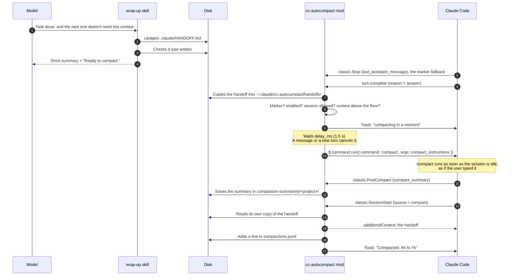

# Architecture

How the pieces fit, which events the mod listens to, what state it keeps, and what happens when something fails.

## Who does what

| Layer | Piece | Job | What it does not do |
| --- | --- | --- | --- |
| Judgment | Rule in `CLAUDE.md` + `wrap-up` skill | Decide whether the next task needs the context; leave the handoff; write the marker only when everything is safe | Compact (it can't) |
| Action | The mod (`plugin/hooks/register.ts`) | See the marker, apply the filters (session, floor, activity) and compact | Judge whether it's time to close; write the handoff |
| Memory on disk | The mod, on `classic.PostCompact` | Save every compaction summary | Decide anything |
| Continuity | The mod, on `classic.SessionStart` (`compact`, `clear`) | Put the handoff back into the context | Write the handoff |
| Safety net | Claude Code's own auto-compact | Compact when the window fills up | Nothing new: left as it is |

The split comes from one constraint in Claude Code: no hook, no skill and not the model can run `/compact`. A mod can, with `$.command.run({ command: 'compact' })`, which queues `/compact` in the session as if the user typed it. (The mod API also has `$.session.compact()`, but in the desktop app, where every session runs headless, engine 2.1.309 always rejects it; see [DECISIONS.md](DECISIONS.md#d12-compact-by-queueing-compact-not-with-sessioncompact).) The judgment stays with the model because it is the only one that knows whether a task is done.

Until 0.3.0 the summary and the handoff were two Python hooks in `settings.json`. Since 0.4.0 the mod handles both events itself ([D15](DECISIONS.md#d15-one-plugin-no-python-no-settingsjson)), so the whole thing is one plugin.

## An automatic close, step by step

With `/compact-now` it starts earlier: the mod sets the `wrapping` phase, runs the skill with `$.command.run` (first as `wrap-up`, then as `cc-autocompact:wrap-up`, since a plugin's skill may only answer to its namespaced name) and, when that turn ends, compacts without looking at the floor or the session list. If neither name runs, the mod asks for the skill in plain words with `$.prompt.submit` (the host refuses text that starts with `/`).

## Events the mod listens to

| Event | What it does |
| --- | --- |
| `session.start` | Registers `/compact-now` and clears "scheduled", "compacting" and "turn running" (timers don't survive a reload). |
| `prompt.submit` | Bumps the `gen` counter: cancels any compaction still waiting out its delay. |
| `turn.start` | Main thread only: marks a turn as running, bumps `gen`, clears what `Stop` saw and allows a new compaction (unless the turn is the `/compact` itself). |
| `classic.Stop` | Main thread only (no `agent_id`): records whether `last_assistant_message` ends with the marker. Read only if `turn.complete` arrives without text. |
| `classic.PostCompact` | Main thread only: writes `compact_summary` to `<summaries>/<project folder>/<UTC time>_<session>.md`. Every compaction, whoever started it. |
| `classic.SessionStart` | `source` `compact` or `clear`, main thread only: returns the mod's own copy of this project's handoff as `additionalContext`. It never reads the project's file here. |
| `turn.complete` | Main thread only: if a `/compact` is queued, marks it done; otherwise looks for the marker. With the marker, copies the handoff into the mod's folder and, if the filters allow, schedules the compaction. In debug mode, writes the decision. |
| `command.run` (`compact-now`) | Starts a wrap-up the user asked for. |

## Where it reads and writes

The mod works out Claude Code's folder from `CLAUDE_CONFIG_DIR`, else the home folder (`USERPROFILE` when it is a Windows drive path, since `HOME` can be a Git Bash path there), plus `.claude`. Its own files go in `<that>/cc-autocompact/`, outside the plugin, so an update never touches them. With no home folder at all, it falls back to the plugin folder.

| File | By | When |
| --- | --- | --- |
| `.claude/HANDOFF.md` (or the `Handoff:` path in `CLAUDE.md`) | `wrap-up` skill | Every wrap-up |
| `~/.claude/cc-autocompact/config.json` | You, optional | Read on every use |
| `~/.claude/cc-autocompact/handoffs/<hash>.json` | Mod | Every main-thread turn that ends with the marker: its copy of the project's handoff |
| `~/.claude/compaction-summaries/<project>/<date>_<time>Z_<id>.md` (or `summaries_dir`, inside `~/.claude`) | Mod | Every compaction (manual, automatic, or from the mod) |
| `~/.claude/cc-autocompact/compactions.jsonl` (or `log_file`, a `.jsonl` inside that folder) | Mod | Every compaction the mod runs |
| `~/.claude/cc-autocompact/debug.jsonl` | Mod, only with `"debug": true` | Every main-thread turn end and every compaction step (last 400 lines) |

The handoff path: a `Handoff: <path>` line in the nearest `CLAUDE.md` (the mod reads them with `$.fs.ancestors`), else `.claude/HANDOFF.md`, relative to the session's folder. The path must be a relative `.md` path inside the project (no `~`, no `..`, no absolute path); a line that breaks that rule is ignored with one toast. The mod reads the file only when a turn ends with the marker, and only if its real path (links followed) is inside the project's real path. The skill follows the same rules, so they agree.

The copy is named by a SHA-256 of the project folder and records that folder; at `SessionStart` it is used only if the folder matches. A wrap-up whose file is missing or refused empties the copy, so an older one never comes back. The mod writes nowhere else: `summaries_dir` and `log_file` outside its folders are refused ([SECURITY.md](../SECURITY.md)).

## Session state

The mod keeps one value per session (`$.state`, contract in [`plugin/types/index.d.ts`](../plugin/types/index.d.ts)). It doesn't survive closing the session, and doesn't need to.

| Field | What for |
| --- | --- |
| `phase` | `idle` or `wrapping` (`/compact-now` started a wrap-up and the mod is waiting for its turn). A wrap-up older than 15 minutes is considered stale. |
| `trigger` | `manual` when it comes from `/compact-now`; the automatic one logs `task_done`. |
| `inTurn` | A main-thread turn is running: never compact. |
| `gen` | Activity counter. If it changes during the delay, the compaction is cancelled. |
| `justCompacted` | Just compacted, no turn since: stops two compactions in a row. The `/compact` turn itself doesn't clear it. |
| `scheduled`, `scheduledAt` | A compaction is waiting out its delay: stops a second one being scheduled (expires after 10 minutes). |
| `compacting`, `compactingAt`, `compactBefore`, `compactTrigger` | `/compact` is queued and its result hasn't been seen. The first sign (what `$.command.run` returns, or the end of the `/compact` turn) closes it exactly once: toast, log and debug line. With no sign in 10 minutes, it is considered lost. |
| `stopMarker`, `stopTail` | What the main thread's `Stop` event saw in this turn (the marker fallback). |
| `title`, `titleAt`, `titleTriedAt`, `titleWarned` | Cached session title (30 minutes), a retry every 2 minutes, and a single warning if it can't be found. |
| `configWarned` | Already said once that `config.json` is not valid JSON. |
| `pathWarned`, `handoffWarned` | Already said once that `summaries_dir` or `log_file` point outside the mod's folders, or that the `Handoff:` line was ignored. |

## Safety rules

1. **Never with a turn running.** Checked when scheduling and again when the delay ends, and `/compact` waits in the queue until the session is idle.
2. **Never twice in a row** without a turn in between, and never two at once. The `/compact` turn doesn't count: if it keeps the message with the marker, it doesn't fire again.
3. **Any activity cancels.** A message from the user or a new turn during the delay.
4. **Only the exact marker on the last line of the model's own answer**, bold or italic aside. "I am not Ready to compact." doesn't fire, and neither does a quoted marker (block quote, quotes, backticks, an open code block), a tool's output, a file or a subagent.
5. **A wrap-up that ends badly doesn't compact.** If the `/compact-now` turn ends interrupted, with an error or without the marker, the mod says so and does nothing.
6. **Subagents don't count**, for the trigger, the summaries or the handoff.
7. **No config means defaults; a broken config means off.** A missing `config.json` runs on the defaults. One that isn't valid JSON switches the automatic trigger off and says so once, so a typo never turns on what you had turned off.
8. **The turn never breaks.** Everything the mod does runs inside `try`; if something fails, it just doesn't compact, save or re-inject.
9. **The log never clobbers history.** If the file exists and can't be read, nothing is written.
10. **A refusal isn't swallowed.** If the engine refuses to queue `/compact`, the mod retries twice (3 s apart), then shows the exact reason and is free again.
11. **Only its own handoff goes back.** What is re-injected is the copy the mod took when your wrap-up ended, never a file a repository brought ([D18](DECISIONS.md#d18-only-the-mods-own-copy-of-the-handoff-goes-back)).
12. **It writes only in its folders and calls nothing outside.** No network, no shell, no `eval`; config paths stay inside `~/.claude`.

## Tests

`plugin/hooks/register.test.ts` holds 67 tests that run against the real engine with `claude plugin test plugin`. The test engine answers like the desktop app: `$.session.compact()` always rejects, and `/compact` is handled as a command. They cover the trigger and the log, the marker with decoration, sentences that aren't the marker, a custom marker, a session outside the list, the floor, `"*"`, no `config.json` at all, a partial one, a broken one, `CLAUDE_CONFIG_DIR`, a Windows home folder next to a Git Bash `HOME`, the app folder found under `LOCALAPPDATA`, the switch, cancelling with a message, two in a row and the `/compact` turn itself, a single close when `/compact` ends its turn before `command.run` answers, a refusal with a retry, three refusals, the `Stop` fallback (and that a subagent's or an earlier turn's doesn't count), subagents, debug on and off, `/compact-now` (normal, another skill, with arguments, interrupted, the namespaced skill name, the plain-words fallback), saving summaries (and `"off"`, and subagents), and putting the handoff back (after a compaction and a `/clear`, not at startup, the `Handoff:` line, the length cap, no file, switched off). The 28 tests named `security: ...` cover what [SECURITY.md](../SECURITY.md) promises: a handoff shipped in a cloned repository, one changed after the wrap-up, a copy from another folder or tampered with, links that lead outside the project, seven hostile `Handoff:` lines, a quoted marker and an open code block, the `Stop` fallback against a real answer, hostile `summaries_dir`, `log_file`, `close_skill` and `marker` values, a project folder named `..`, and capped numbers.

What the tests can't cover, because it needs a real, signed-in session: whether the `/compact` summary is good, and whether the engine raises `classic.PostCompact` and `classic.SessionStart` for the mod in the desktop app exactly as the test engine does. The live run on 31 October 2026 (0.2.0, with the Python hooks) confirmed the compaction and the saved summary.
